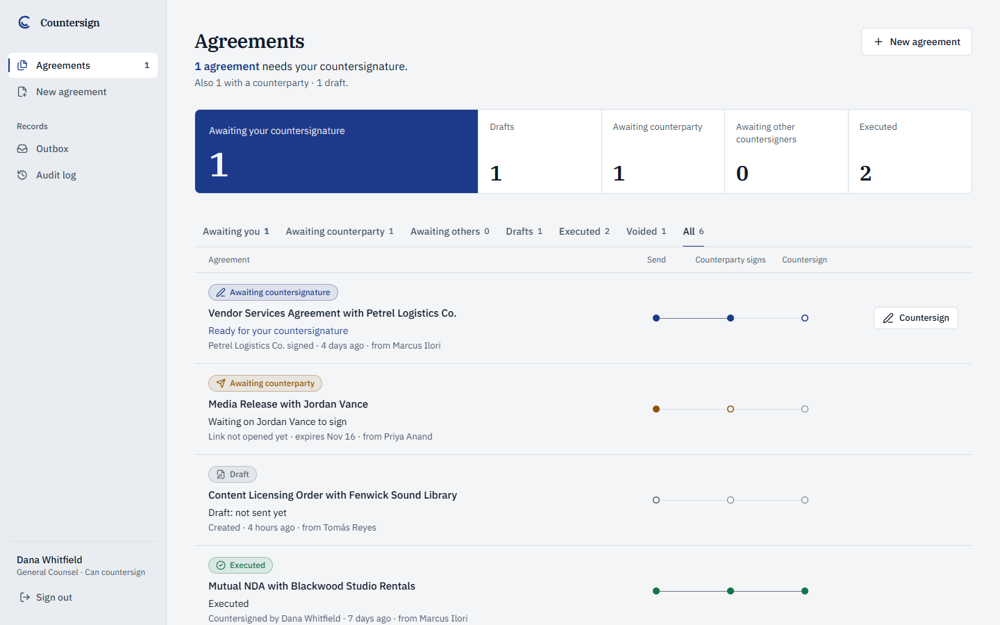

# Countersign

Two-party agreements with a fixed signing order. The counterparty signs first through a private link, then the company's designated signatory countersigns. The server enforces that order, and so does the database.

Live: [countersign-demo-seven.vercel.app](https://countersign-demo-seven.vercel.app)



Built by [Michael Palaganas](https://michaelrhey.com) as a standalone version of the MNDA signing workflow he built at Valiant.

## What it does

1. A sender creates an agreement from a template and previews the PDF.
2. **Send** freezes the PDF and records its SHA-256 fingerprint. A single-agreement signing link is issued for the counterparty.
3. The counterparty opens the link (no account), reviews the frozen PDF, and signs by drawing on a canvas.
4. The agreement moves to **Awaiting countersignature**. Only the designated company signatory can countersign.
5. On countersignature the agreement is **Executed**: both signatures and a completion page are stamped onto the frozen PDF, and both parties can download it.

A sender can also **void** an agreement or **reissue** the signing link, which kills the old one. Every step is written to an append-only history, shown at `/audit`.

States: `DRAFT`, `AWAITING_COUNTERPARTY`, `AWAITING_COUNTERSIGNATURE`, `EXECUTED`, `VOIDED`.

Notifications are recorded in an in-app outbox instead of an inbox. Open a signing link from the outbox to act as the counterparty. Countersign has no email, Google Drive or webhook integration.

## Signing-order guarantees

The order is enforced below the UI.

- **Guarded transitions.** Each step is an `updateMany` whose `where` clause names the status it expects. If two requests race, one updates a row and the other updates none and is rejected. See `src/lib/documents.ts`.
- **Database constraints.** CHECK constraints tie the status to the signing timestamps and require the countersignature to come after the counterparty signature. A bug in the app cannot write an impossible state.
- **Designated signer.** Each agreement names its countersigner, and only that user can countersign. Managing an agreement (send, reissue, void) is limited to its sender and the designated countersigner.
- **Frozen document.** Send fixes the PDF bytes and their SHA-256. Execution adds pages to that file instead of re-rendering it, so what the counterparty saw is what was executed. A ready artifact cannot be modified (trigger).
- **Signing links.** 256 random bits, only the SHA-256 is stored, valid for 14 days (30 days read-only after execution), and revoked by reissue or void. Responses under `/s/` send `Referrer-Policy: no-referrer`, `Cache-Control: no-store` and `noindex`. Anyone holding the link can act as the counterparty; there is no second factor.
- **Append-only history.** `StatusEvent` rejects UPDATE and DELETE by trigger. Counterparty events store a keyed HMAC of the client IP, never the address.

## Canvas signatures

The browser draws strokes with `signature_pad` and submits a PNG data URL. The server treats it as untrusted input (`src/lib/signature.ts`): it must be a PNG data URL, at most 250 KB and 2400 by 1200 pixels, structurally valid, and decodable. Only the decoded bytes are used, embedded into the PDF with `pdf-lib`. The image is never placed into HTML and never fetched.

## Architecture

- Next.js 16 (App Router), React 19, TypeScript, Tailwind CSS 4
- PostgreSQL through Prisma 7 with the `pg` driver adapter
- Auth.js (NextAuth v5), credentials and JWT sessions, for the company side
- `puppeteer-core` with `@sparticuz/chromium` renders the agreement PDF once, at Send
- Vitest with an embedded Postgres; GitHub Actions runs typecheck, lint, test and build
- Deployed on Vercel with a Neon Postgres database

## Run it locally

You need Node 24 (22.17 or newer works) and a local PostgreSQL.

```bash
npm ci
cp .env.example .env        # fill in DATABASE_URL and AUTH_SECRET
npm run db:deploy           # apply migrations (uses DIRECT_URL, else DATABASE_URL)
npm run seed                # sample company and agreements; refuses a non-local database
npm run dev                 # http://localhost:3000
```

The sign-in page offers two one-click sample accounts: the company's designated countersigner and a sender who is not a signatory. The seed creates agreements at every stage, including draft, executed and voided.

```bash
npm run verify    # typecheck, lint, test, build
```

The test suite and the seed refuse non-local database URLs unless explicitly overridden.

## Sample workspace behavior

The hosted instance is a shared sample workspace, so it is built to stay tidy. These behaviors apply when `DEMO_MODE=1` and are off for local development.

- **Fresh sessions, not deletes.** The workspace resets by creating a new session and reseeding it. Earlier sessions and their history stay in the database. Pages show only the current session, and an old signing link says the workspace was reset.
- **Idle reset.** After 30 minutes without changes, the next signed-in visit prepares a fresh session. There is no cron job. A failed reset is not retried for 5 minutes, and a lease ensures only one runs at a time.
- **Limits per session.** 30 agreements and 60 signing links, enforced by database triggers.
- **Reserved addresses only.** Counterparty emails must use reserved domains such as `company.example`, enforced by the database as well as the form.
- **Fail closed.** In production the app refuses to send or sign without `OUTBOX_ENCRYPTION_KEY`, `AUDIT_IP_HMAC_KEY` and an explicit `DELIVERY_MODE`.
- **Kept out of search.** `noindex` metadata, an `X-Robots-Tag` header and a `robots.txt` that disallows everything.

Environment variables are listed in `.env.example`. Deployment notes and the migration procedure are in [`docs/deployment-checklist.md`](docs/deployment-checklist.md).

Sample company and agreements. Not legal advice.
